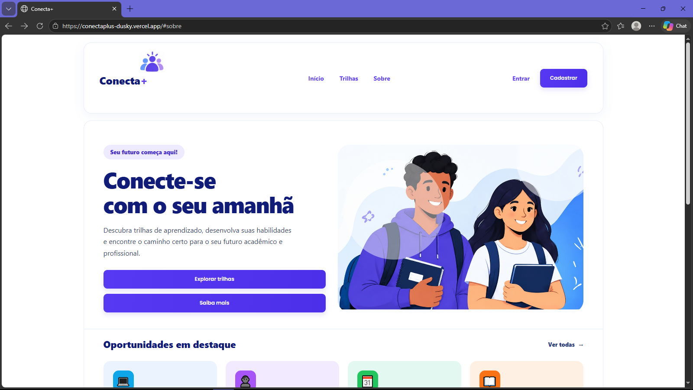
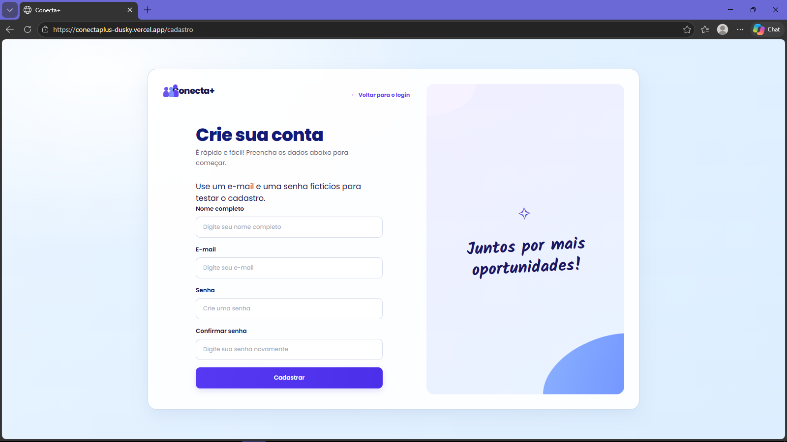
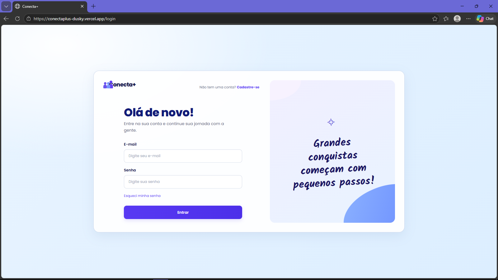
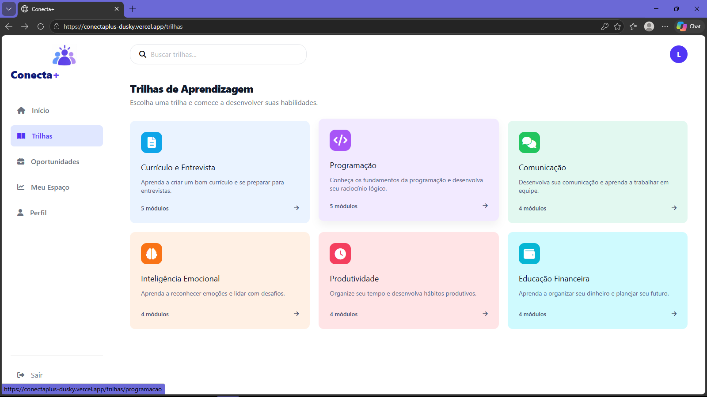
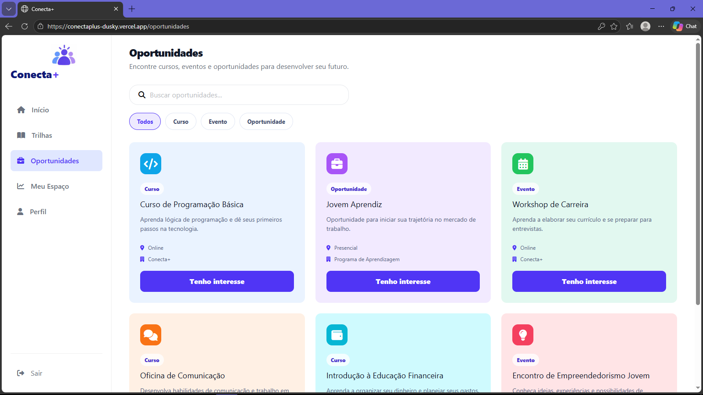
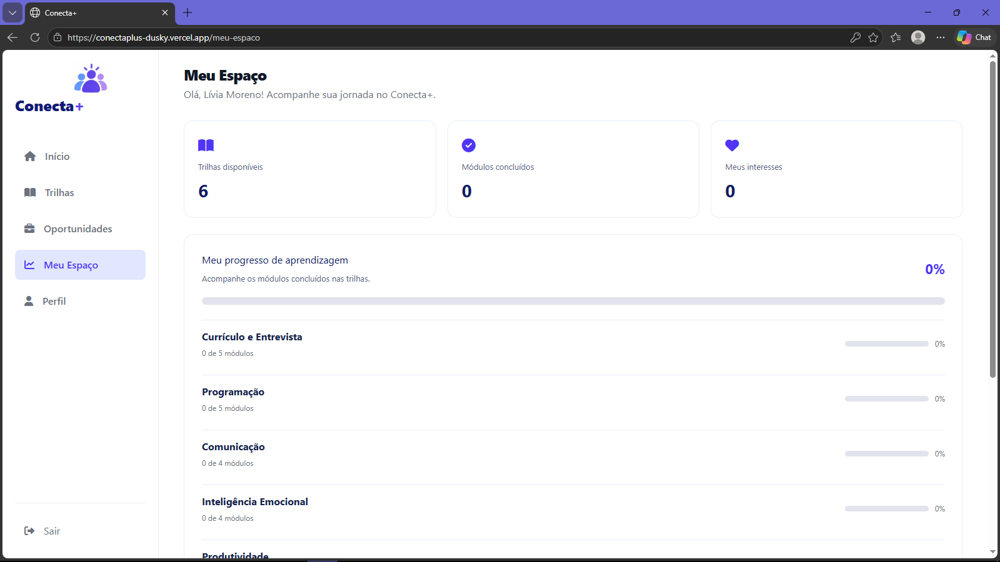
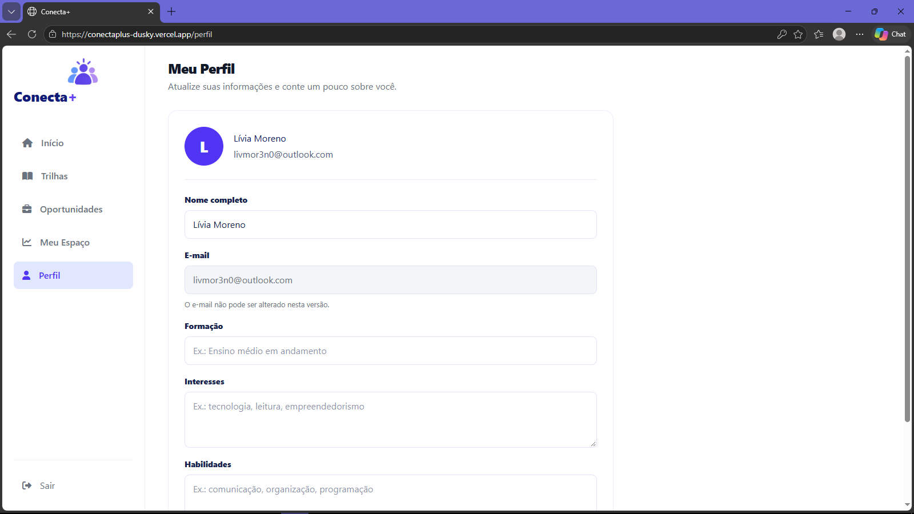

<div align="center">
  

  <p>
    <a href="https://github.com/Avena-JABAL/conectaplus">
      
    </a>
    
    
  </p>
</div>

---
## Versão

**Conecta+ v1.0.0**


## Integrantes do projeto

| Nome | Matrícula |
| --- | --- |
| Alyson Coutinho dos Passos Silva | `01812644` |
| Arthur Fernandes do Nascimento Correia | `01848451` |
| Beatriz Jordão Albuquerque | `01812582` |
| Júlia Evelyn Santiago de Holanda | `01803734` |
| Lívia de Oliveira Moreno | `01800123` |


## Sobre o projeto

O **Conecta+** é uma proposta de plataforma digital que conecta jovens a oportunidades de trabalho, mentoria, capacitação e participação em projetos de impacto social.

O projeto busca fortalecer o protagonismo juvenil, ampliar a empregabilidade e incentivar o empreendedorismo, reunindo em um só lugar recursos para que cada jovem possa descobrir seus interesses e dar os próximos passos em sua trajetória.

## O problema

Muitos jovens encontram dificuldade para localizar oportunidades de emprego, estágio, voluntariado e formação. Essas informações costumam estar dispersas, enquanto o acesso a orientação profissional e a redes de apoio também pode ser limitado.

O Conecta+ propõe centralizar essas oportunidades e aproximar jovens de pessoas, iniciativas e conteúdos que apoiem seu desenvolvimento pessoal e profissional.

## O objetivo

Desenvolver uma plataforma digital que facilite o acesso dos jovens a oportunidades profissionais, educacionais e sociais, incentivando a aprendizagem, o desenvolvimento de habilidades e o empreendedorismo.

## A proposta

Criar um espaço acessível e acolhedor em que jovens possam apresentar seus interesses e habilidades, encontrar oportunidades locais, aprender, receber orientação e compartilhar iniciativas com a comunidade.

## Funcionalidades do projeto

O Conecta+ reúne funcionalidades voltadas ao desenvolvimento pessoal e profissional dos jovens:

| Funcionalidade | Descrição |
|---|---|
| **Cadastro e autenticação** | Cadastro, login, recuperação de senha e logout simulados. |
| **Rotas protegidas** | Controle de acesso às páginas restritas para usuários autenticados. |
| **Trilhas de aprendizagem** | Acesso a seis trilhas, busca por conteúdos e acompanhamento da conclusão dos módulos. |
| **Oportunidades** | Visualização de oportunidades fictícias, pesquisa, filtros por tipo e marcação de interesse. |
| **Meu Espaço** | Acompanhamento do progresso nas trilhas e visualização das oportunidades salvas. |
| **Perfil** | Edição de informações relacionadas à formação, interesses e habilidades. |
| **Responsividade** | Interface adaptada para diferentes tamanhos de tela. |

## Recursos do React aplicados

Durante o desenvolvimento do Conecta+, foram utilizados recursos do React para organizar os componentes, controlar os dados e criar interações na interface.

| Recurso | Aplicação no projeto |
|---|---|
| **Componentes** | Organização da interface em partes reutilizáveis. |
| **Props** | Compartilhamento de informações entre componentes. |
| **useState** | Controle de estados, como dados dos formulários, filtros e interações. |
| **Context API** | Compartilhamento de informações de autenticação entre diferentes partes da aplicação. |
| **React Router** | Gerenciamento da navegação entre páginas e implementação de rotas protegidas. |
| **Renderização dinâmica** | Exibição de listas e informações de acordo com os dados disponíveis. |
| **Eventos e formulários** | Captura de informações digitadas e execução de ações do usuário. |

## Impacto esperado

O Conecta+ busca ampliar o acesso dos jovens a oportunidades de desenvolvimento pessoal e profissional, contribuindo para a construção de um futuro com mais possibilidades.

Por meio da plataforma, esperamos:

- **Ampliar o acesso à informação:** facilitar a busca por oportunidades de emprego, capacitação e aprendizagem.
- **Incentivar o desenvolvimento profissional:** estimular os jovens a desenvolver habilidades e conhecimentos importantes para o mercado de trabalho.
- **Promover a inclusão:** aproximar jovens de diferentes realidades de oportunidades de crescimento.
- **Estimular o protagonismo juvenil:** incentivar os usuários a assumirem um papel ativo na construção de suas trajetórias.
- **Fortalecer conexões:** aproximar jovens de oportunidades, projetos e iniciativas que possam contribuir para seu desenvolvimento.

## Limites do protótipo

O Conecta+ foi desenvolvido como um protótipo acadêmico, com foco na demonstração das funcionalidades e da navegação da plataforma. Por isso, apresenta algumas limitações:

- **Sem banco de dados:** as informações são armazenadas temporariamente durante a utilização da aplicação.
- **Autenticação simulada:** o cadastro e o login não utilizam um servidor de autenticação real.
- **Dados fictícios:** as oportunidades e informações apresentadas são utilizadas apenas para demonstração.
- **Recuperação de senha simulada:** o sistema não envia e-mails para redefinição de senha.
- **Dados temporários:** informações de cadastro, perfil e progresso podem ser perdidas ao atualizar ou fechar a página.
- **Funcionalidades futuras:** recursos como emissão de certificados, fórum e mentoria real não fazem parte desta versão.

Essas limitações representam possibilidades de evolução para versões futuras do Conecta+.

## Tecnologias utilizadas

- **React:** construção da interface e organização dos componentes.
- **React Router:** gerenciamento da navegação entre páginas.
- **Context API:** compartilhamento de estados entre componentes.
- **JavaScript:** implementação da lógica e interatividade.
- **Vite:** ferramenta de desenvolvimento e construção da aplicação.
- **Tailwind CSS:** estilização da interface.
- **CSS:** personalização dos estilos e layouts.
- **Oxlint:** análise estática do código.

## Instalação e execução

### Requisitos

- Node.js 22.12 ou superior.
- npm.

### 1. Clonar o repositório

```bash
git clone https://github.com/Avena-JABAL/conectaplus.git
```

### 2. Entrar na pasta do projeto

```bash
cd conectaplus
```

### 3. Instalar as dependências

```bash
npm ci
```

### 4. Executar o projeto

```bash
npm run dev
```

Abra no navegador a URL local informada pelo Vite, normalmente:

[http://localhost:5173](http://localhost:5173)

## Verificação e construção

Para executar as verificações do projeto, utilize:

**Testes automatizados:**

```bash
npm test
```

**Análise de código:**

```bash
npm run lint
```

**Construção da aplicação:**

```bash
npm run build
```

**Visualização da versão construída:**

```bash
npm run preview
```

O comando `npm run build` gera a pasta `dist/`, contendo os arquivos de produção. O comando `npm run preview` permite verificar localmente a versão construída.

## Rotas

| Rota | Acesso |
|---|---|
| `/` | Público |
| `/cadastro` | Público |
| `/login` | Público |
| `/recuperar-senha` | Público |
| `/logoff` | Público |
| `/trilhas` | Autenticado |
| `/trilhas/:id` | Autenticado |
| `/oportunidades` | Autenticado |
| `/meu-espaço` | Autenticado |
| `/perfil` | Autenticado |

## Capturas de tela

Esta seção apresenta as principais telas da aplicação, demonstrando a interface e as funcionalidades desenvolvidas.

**Landing Page**



**Cadastro**



**Login**




**Trilhas de Aprendizagem**



**Oportunidades**



**Meu Espaço**



**Perfil**




## Implantação

O Conecta+ está publicado por meio da plataforma Vercel.

**Acesse a aplicação:** [https://conectaplus-dusky.vercel.app/](https://conectaplus-dusky.vercel.app/)

O arquivo `vercel.json` configura a implantação do projeto, incluindo o processo de build, a pasta de saída e o redirecionamento das rotas da aplicação.


## Homologação e apresentação

O Conecta+ passou pela validação das principais funcionalidades e fluxos de navegação da plataforma.

Foram verificados os seguintes aspectos:

- Cadastro e login simulados.
- Recuperação de senha e logout.
- Proteção das rotas restritas.
- Navegação entre as páginas.
- Pesquisa e filtros de oportunidades.
- Busca e conclusão de módulos das trilhas.
- Edição de perfil.
- Acompanhamento do progresso em Meu Espaço.
- Responsividade da interface.

Os testes automatizados verificam aspectos como o isolamento dos dados por conta e a consistência das trilhas. Os fluxos principais também foram validados no navegador.

O roteiro de testes e apresentação está disponível em [docs/homologacao.md](docs/homologacao.md).


## Repositórios e links

- **GitHub:** [Acesse o repositório do Conecta+](https://github.com/Avena-JABAL/conectaplus)
- **Aplicação publicada:** [Acesse o Conecta+](https://conectaplus-dusky.vercel.app/)

---

<div align="center">

**Conecta+ — conexões que aproximam jovens de novas oportunidades.**

</div>
